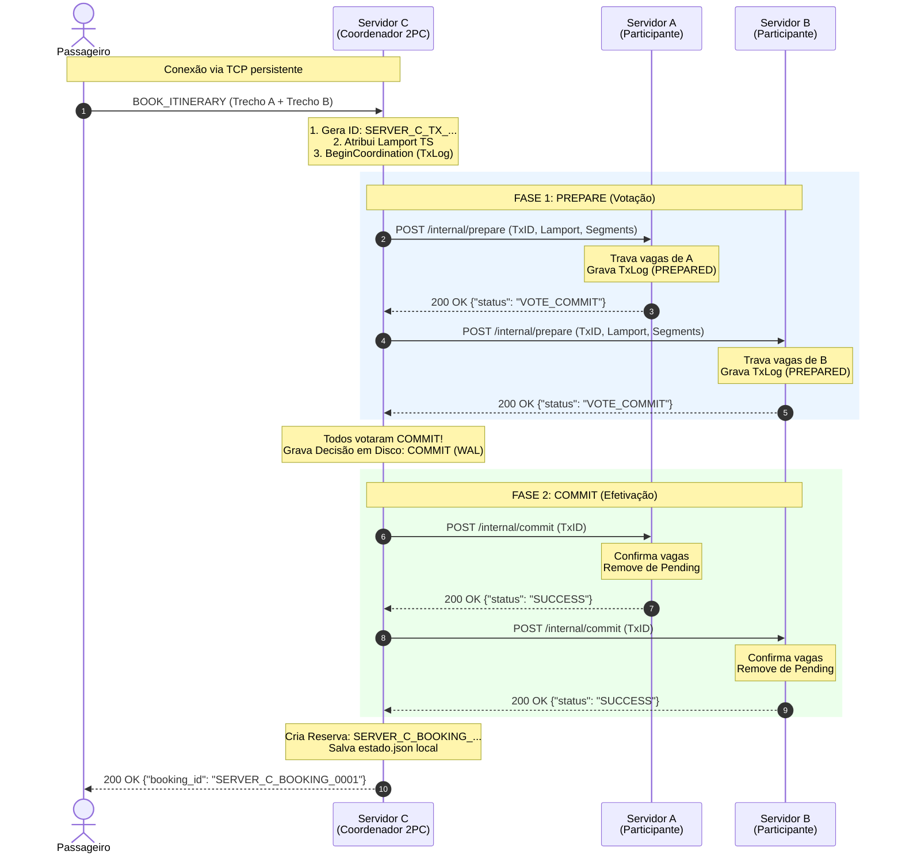
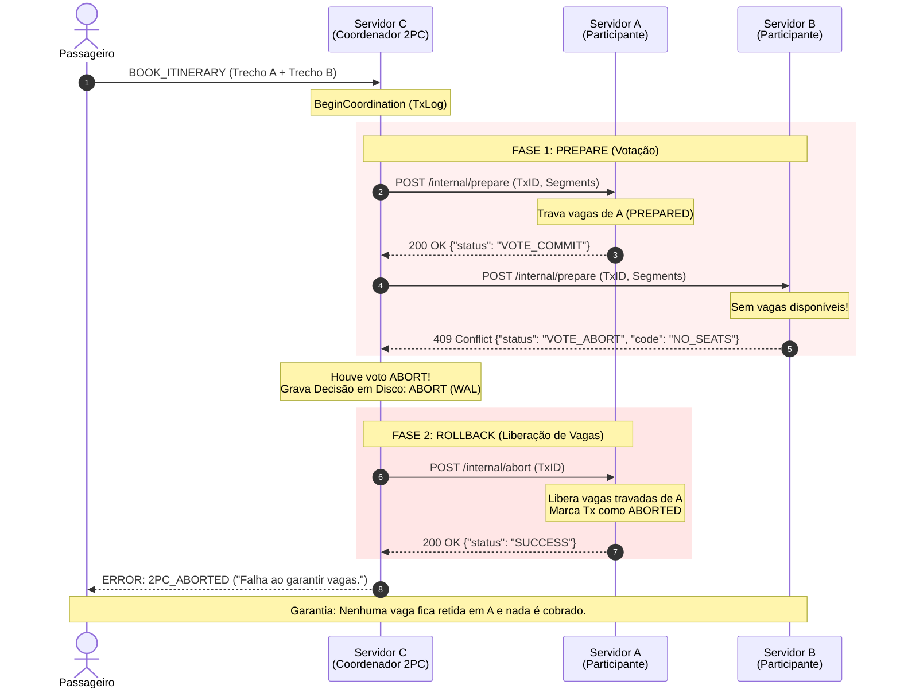
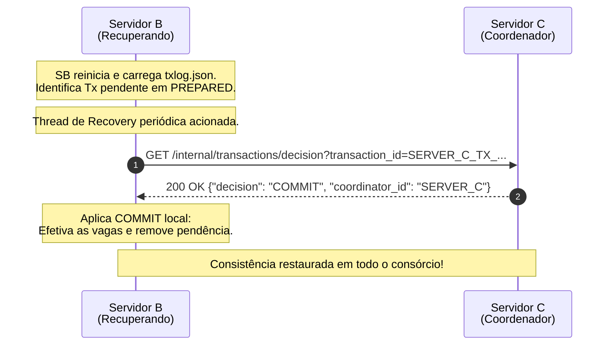

# Contrato da API REST Interna entre os Servidores do Consórcio

Este documento descreve a especificação formal da API REST exposta e consumida exclusivamente pelos servidores dos membros do consórcio VaiJunto (`SERVER_A`, `SERVER_B`, `SERVER_C`). 

A comunicação com os clientes (motorista e passageiro) ocorre via protocolo de aplicação sobre TCP persistente, conectando-se cada cliente exclusivamente ao servidor da sua empresa de origem. A cooperação entre as empresas para busca consolidada, reserva atômica distribuída (Two-Phase Commit - 2PC), cancelamento com devolução de assentos e recuperação de transações é integralmente realizada através dos endpoints REST descritos a seguir.

---

## 1. Convenções Gerais

- **Protocolo e Formato**: Todas as requisições e respostas utilizam HTTP/1.1 com corpos formatados em JSON (`application/json; charset=utf-8`).
- **Prefixo dos Recursos**: Todos os endpoints inter-servidores encontram-se sob o prefixo `/internal/` para isolamento de contexto e regras de firewall corporativo.
- **Identificadores Únicos Universais**:
  - **Caronas**: `{SERVER_ID}_RIDE_{NNNN}` (ex.: `SERVER_A_RIDE_0001`). O prefixo garante ausência de colisões entre os catálogos dos diferentes parceiros.
  - **Transações Distribuídas**: `{COORDINATOR_ID}_TX_{UNIX_NANO}` (ex.: `SERVER_C_TX_1730000000000000000`), geradas pelo nó que coordena a reserva no momento em que o passageiro submete o pedido.
  - **Reservas**: `{SERVER_ID}_BOOKING_{NNNN}` (ex.: `SERVER_C_BOOKING_0001`), registradas unicamente no servidor ao qual o passageiro está conectado.

### Formato de Erro Padronizado

Em caso de requisições inválidas, falhas de validação ou recusa de votos durante a coordenação, o servidor responde com o envelope padronizado:

```json
{
  "code": "NO_SEATS",
  "message": "Sem vagas disponíveis no trecho Feira -> Conquista"
}
```

---

## 2. Precedência e Ordenação Distribuída

Conforme os requisitos do consórcio, os relógios físicos dos servidores não são sincronizados e as mensagens de rede estão sujeitas a latências variáveis. Para solucionar disputas simultâneas pelo último assento de um mesmo trecho entre passageiros conectados a empresas distintas:

1. **Relógio Lógico de Lamport**: Cada transação gerada pelo coordenador recebe um timestamp escalar de Lamport (`lamport_time`). O relógio é incrementado em cada evento interno e atualizado a cada mensagem recebida segundo a regra:
   $$L_{\text{local}} = \max(L_{\text{local}}, L_{\text{recebido}}) + 1$$
2. **Tupla de Ordem Total**: A precedência estrita entre duas transações $A$ e $B$ é dada pela tupla lexicográfica:
   $$(L_A, \text{CoordinatorID}_A) < (L_B, \text{CoordinatorID}_B)$$
3. **Desempate Determinístico**: A transação com menor tupla tem prioridade. Caso duas requisições disputem o mesmo assento:
   - Se uma transação de maior prioridade chegar enquanto uma de menor prioridade estiver no estado `PREPARED` (sem decisão final), o participante rejeita a de menor prioridade ou aplica o critério determinístico, respondendo com voto de recusa (`VOTE_ABORT` / HTTP 409).

---

## 3. Especificação dos Recursos da API

### 3.1. GET `/internal/rides`

Consulta as caronas registradas no catálogo local do servidor parceiro para uma determinada data. É utilizado durante o algoritmo de busca em grafo (BFS) para descobrir itinerários diretos ou combinados.

- **Método**: `GET`
- **Query Params**:
  - `date` *(obrigatório)*: Data no formato ISO `AAAA-MM-DD`.

#### Resposta de Sucesso (HTTP 200 OK)
```json
[
  {
    "id": "SERVER_A_RIDE_0001",
    "company_id": "SERVER_A",
    "driver_token": "motorista_salvador",
    "route": ["Salvador", "Feira"],
    "date": "2026-11-15",
    "time": "08:00",
    "total_seats": 3,
    "segments": [
      {
        "from": "Salvador",
        "to": "Feira",
        "price": 35.00,
        "available_seats": 3
      }
    ]
  }
]
```

#### Respostas de Erro
- **HTTP 400 Bad Request** (`INVALID_DATA`): Parâmetro `date` ausente ou fora do formato `AAAA-MM-DD`.
- **HTTP 500 Internal Server Error** (`INTERNAL_ERROR`): Falha inesperada ao consultar o repositório local.

---

### 3.2. POST `/internal/prepare`

Executa a **Fase 1 do Two-Phase Commit (2PC)**. O coordenador envia o itinerário completo ao participante. O participante verifica exclusivamente os trechos pertencentes à sua empresa (`company_id == SelfID`) e tenta efetuar o bloqueio provisório das vagas na memória e no log de transações.

- **Método**: `POST`
- **Idempotência**: Sim. Chamadas repetidas com o mesmo `transaction_id` retornam o mesmo voto sem decrementar assentos adicionais.

#### Corpo da Requisição (Request Body)
```json
{
  "transaction_id": "SERVER_C_TX_1730000000000000000",
  "lamport_time": 42,
  "coordinator_id": "SERVER_C",
  "itinerary": {
    "itinerary_id": "ITIN_SALVADOR_CONQUISTA",
    "total_price": 75.00,
    "departure_time": "08:00",
    "available_seats": 2,
    "drivers": ["motorista_A", "motorista_B"],
    "segments": [
      {
        "ride_id": "SERVER_A_RIDE_0001",
        "company_id": "SERVER_A",
        "driver_token": "motorista_A",
        "from": "Salvador",
        "to": "Feira",
        "departure_time": "08:00",
        "price": 35.00,
        "available_seats": 3
      },
      {
        "ride_id": "SERVER_B_RIDE_0001",
        "company_id": "SERVER_B",
        "driver_token": "motorista_B",
        "from": "Feira",
        "to": "Conquista",
        "departure_time": "10:30",
        "price": 40.00,
        "available_seats": 2
      }
    ]
  }
}
```

#### Resposta de Voto Favorável (HTTP 200 OK)
Emitido quando o participante consegue garantir e travar localmente todos os assentos sob sua responsabilidade:
```json
{
  "status": "VOTE_COMMIT",
  "message": "Preparado para confirmar."
}
```

#### Resposta de Voto Contrário (HTTP 409 Conflict)
Emitido quando o trecho não possui vagas suficientes, carona não existe ou há conflito de concorrência:
```json
{
  "status": "VOTE_ABORT",
  "code": "NO_SEATS",
  "message": "Vagas esgotadas neste nó."
}
```

---

### 3.3. POST `/internal/commit`

Executa a **Fase 2 do Two-Phase Commit (Decisão Global de Confirmação)**. O participante efetiva em definitivo a reserva das vagas travadas na Fase 1, remove a pendência do seu log e persiste o estado em disco.

- **Método**: `POST`
- **Idempotência**: Sim. Reexecuções não alteram a quantidade de vagas e retornam sucesso.

#### Corpo da Requisição (Request Body)
```json
{
  "transaction_id": "SERVER_C_TX_1730000000000000000",
  "coordinator_id": "SERVER_C"
}
```

#### Resposta de Sucesso (HTTP 200 OK)
```json
{
  "status": "SUCCESS",
  "message": "Commit efetivado."
}
```

---

### 3.4. POST `/internal/abort`

Executa a **Fase 2 do Two-Phase Commit (Decisão Global de Cancelamento / Rollback)**. Notifica o participante de que a transação falhou em algum dos membros do consórcio. O participante desfaz o bloqueio provisório, devolve as vagas à carona correspondente e marca a transação como abortada para evitar que um prepare atrasado seja aceito posteriormente.

- **Método**: `POST`
- **Idempotência**: Sim. Se a transação já foi abortada ou não reservou nada neste nó, o servidor retorna sucesso seguro.

#### Corpo da Requisição (Request Body)
```json
{
  "transaction_id": "SERVER_C_TX_1730000000000000000",
  "coordinator_id": "SERVER_C"
}
```

#### Resposta de Sucesso (HTTP 200 OK)
```json
{
  "status": "SUCCESS",
  "message": "Abort efetivado."
}
```

---

### 3.5. POST `/internal/release`

Notificação de **devolução de assentos decorrente do cancelamento voluntário de uma reserva** previamente confirmada por um passageiro. Não necessita de 2PC, pois a liberação de vagas é sempre uma operação segura e idempotente por reserva (`booking_id`).

- **Método**: `POST`
- **Idempotência**: Sim. Controlada via conjunto de `released` de cada servidor pelo identificador `booking_id`.

#### Corpo da Requisição (Request Body)
```json
{
  "booking_id": "SERVER_C_BOOKING_0001",
  "segments": [
    {
      "ride_id": "SERVER_A_RIDE_0001",
      "company_id": "SERVER_A",
      "from": "Salvador",
      "to": "Feira"
    }
  ]
}
```

#### Resposta de Sucesso (HTTP 200 OK)
```json
{
  "status": "SUCCESS",
  "message": "Devolução de vagas processada.",
  "data": "{\"released_segments\":1}"
}
```

---

### 3.6. GET `/internal/transactions/decision`

Mecanismo essencial para o **Protocolo de Recuperação Pós-Queda (Crash Recovery)**. Quando um nó participante reinicia após uma interrupção súbita e encontra transações no estado pendente (`PREPARED`) em seu log em disco (`txlog.json`), ele consulta o coordenador daquela transação para descobrir o desfecho global registrado.

- **Método**: `GET`
- **Query Params**:
  - `transaction_id` *(obrigatório)*: Identificador da transação a ser consultada.

#### Resposta de Sucesso (HTTP 200 OK)
```json
{
  "transaction_id": "SERVER_C_TX_1730000000000000000",
  "decision": "COMMIT",
  "coordinator_id": "SERVER_C"
}
```

*Nota*: Os valores possíveis para `decision` são:
- `"COMMIT"`: O coordenador decidiu confirmar a transação globalmente. O participante deve aplicar o commit local.
- `"ABORT"`: O coordenador abortou a transação. O participante deve devolver os assentos.
- `"IN_PROGRESS"`: A transação ainda está sendo processada pelo coordenador; o participante deve aguardar a próxima rodada do recovery.
- `"UNKNOWN"`: O coordenador não possui registro da transação (ex.: caiu antes de gravar decisão). O participante deve manter a segurança até reconciliação.

---

## 4. Tabela de Códigos de Retorno HTTP e da Aplicação

| HTTP Status | `code` da Aplicação | Significado no Protocolo |
|---|---|---|
| **200 OK** | — | Sucesso na operação, repetição idempotente ou voto favorável `VOTE_COMMIT`. |
| **400 Bad Request** | `INVALID_DATA` | Corpo JSON malformado, parâmetros obrigatórios ausentes ou tipos inválidos. |
| **404 Not Found** | `TRANSACTION_NOT_FOUND` | Transação desconhecida pelo nó consultado. |
| **409 Conflict** | `NO_SEATS` | Voto `VOTE_ABORT`: assentos esgotados no trecho requisitado. |
| **409 Conflict** | `RIDE_NOT_FOUND` | Voto `VOTE_ABORT`: carona especificada não existe no nó participante. |
| **409 Conflict** | `LOWER_PRIORITY` | Voto `VOTE_ABORT`: concorrência simultânea perdida pelo critério de Lamport. |
| **500 Internal Error** | `WORKER_EXECUTION_FAILED` | Falha interna no Single Worker ou erro ao persistir o estado em disco. |

*Tratamento de Timeout*: Caso o coordenador não receba retorno de uma requisição REST dentro do tempo limite estipulado (5 segundos), o nó assume que o parceiro falhou ou a rede partilhou, convertendo o resultado automaticamente para voto de recusa (`VOTE_ABORT`) e acionando o rollback global.

---

## 5. Diagramas de Sequência da Confirmação de Itinerário

### 5.1. Cenário 1: Confirmação com Sucesso (Global Commit)

O passageiro está conectado exclusivamente ao **Servidor C** (sua empresa), que atua como **Coordenador 2PC**. O itinerário selecionado combina um trecho do **Servidor A** (Salvador $\rightarrow$ Feira) e um trecho do **Servidor B** (Feira $\rightarrow$ Conquista).



---

### 5.2. Cenário 2: Abort Global por Vagas Esgotadas ou Falha de Participante

Neste cenário, o **Servidor A** aprova o trecho, mas o **Servidor B** rejeita por falta de vagas (ou sofre timeout). O Coordenador C garante que o itinerário **não seja reservado pela metade**, disparando o abort para o Servidor A e liberando as vagas previamente travadas.



---

### 5.3. Cenário 3: Protocolo de Recuperação Pós-Queda (Crash Recovery)

Caso o **Servidor B** sofra uma queda abrupta logo após responder `VOTE_COMMIT` e antes de receber o `commit`, ao ser reiniciado ele não deixa assentos bloqueados indefinidamente:


